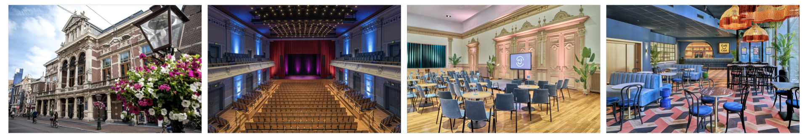
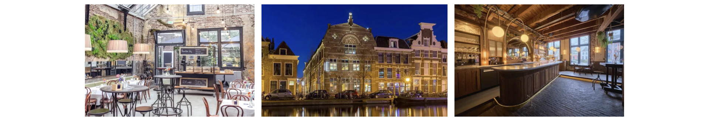
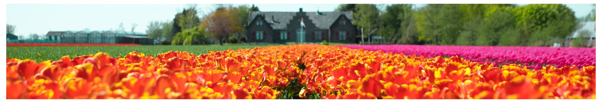

{:.center-image}

# Venue

### Conference Venue

QCTiP 2027 will be held in <strong>Leiden, the Netherlands</strong>, 
  a historic university city renowned for its vibrant academic community, 
  rich cultural heritage, and strong international research environment. 
  Leiden is home to Leiden University, founded in 1575, the oldest 
  university in the Netherlands. 

The conference will be held at the <strong>Stadsgehoorzaal Leiden</strong>, 
  the city's concert hall dating from 1891. It is a prominent venue 
  located in the heart of Leiden. 
  It provides a welcoming setting for bringing together researchers, academics, industry representatives, 
  and students from across the quantum computing community.

{:.center-images}

### Conference Dinner

The conference dinner will take place in a historic venue in the city center of Leiden. 

<!--{: style="width:100%;" .center-image}-->

# Travel Information

### About Leiden

Leiden is a historic university city with over 400 years of academic heritage. It is home to the Kamerlingh Onnes Laboratory, 
where superconductivity was discovered in 1911. Rich in history, Leiden has something to discover around every corner, hundreds of monuments, world-class museums, picturesque canals, and a charming city center, creating a unique atmosphere where centuries of heritage meet modernity. 

The city is very well connected by rail with major Dutch and international destinations and is easily accessible from Amsterdam Airport Schiphol. Most Leiden University buildings and faculties are within walking or cycling distance of the city centre.

**Things to Do in Leiden**

- Burcht van Leiden  – Medieval castle on an artificial mound, with views over the city's rooftops
- Oude Sterrewacht  – 1861 building of Leiden Observatory (founded 1633), the world's oldest operating university observatory
- [Hortus Botanicus](https://hortusleiden.nl/)  – The oldest botanical garden in the Netherlands, founded in 1590
- [Rijksmuseum Boerhaave](https://www.rijksmuseumboerhaave.nl/en)  – National museum of the history of science and medicine, including the apparatus Kamerlingh Onnes used to first liquefy helium
- [Follow the Leiden Wall Formulas](https://muurformules.nl/?ln=en)

### Tulip Season in the Leiden region

The conference takes place in the middle of the tulip season, which runs from mid-March to mid-May. The bulb fields between Leiden and Haarlem are a short ride from the city and are best explored by bike: rent one in Leiden and follow one of the [flower field cycling routes](https://www.leideninternationalcentre.nl/get-advice/blogs/flower-fields-around-leiden) (28–57 km). Along the way you can stop at [Keukenhof](https://keukenhof.nl/en/) in Lisse, one of the world's most famous flower gardens, open from 18 March to 9 May 2027 and also reachable by public transport from Leiden.

{:.center-images}

### Where to Eat in Leiden

Leiden has many charming restaurants, most of them small because of their historic buildings and the limited space in the old city centre. April is high season in Leiden, so restaurants can get busy: booking ahead is recommended, and usually necessary for larger groups. The list below is just a selection of personal suggestions from the organisers.

**Dutch & Casual**
- [’t Pannenkoekenhuysje Oudt Leyden](https://www.google.com/maps/search/?api=1&query=Pannenkoekenhuysje+Oudt+Leyden+Steenstraat+49+Leiden) – Traditional Dutch pancakes, sweet and savoury
- [La Bota](https://www.google.com/maps/search/?api=1&query=La+Bota+Herensteeg+9+Leiden) – Cosy brown-café atmosphere with hearty, affordable food near the Pieterskerk
- [Stadsbrouwhuis](https://www.google.com/maps/search/?api=1&query=Stadsbrouwhuis+Aalmarkt+Leiden) – Leiden’s city brewery, with 20 craft beers on tap and hearty food

**International Cuisine**
- [Het Prentenkabinet](https://www.google.com/maps/search/?api=1&query=Het+Prentenkabinet+Kloksteeg+25+Leiden) – Refined French-inspired cuisine in a historic building with a hidden garden terrace
- [Bar Lokaal](https://www.google.com/maps/search/?api=1&query=Bar+Lokaal+Hartesteeg+13+Leiden) – Seasonal shared plates with excellent vegetarian dishes, in a lively bistro
- [Aperitivo](https://www.google.com/maps/search/?api=1&query=Aperitivo+Breestraat+49+Leiden) – Italian pizza, pasta and small bites, with shared-dining menus for groups
- [Verboden Toegang](https://www.google.com/maps/search/?api=1&query=Verboden+Toegang+Kaiserstraat+7+Leiden) – Modern European cuisine in a playful setting themed around rules and prohibitions
- [Paco Ciao](https://www.google.com/maps/search/?api=1&query=Paco+Ciao+Stationsweg+25+Leiden) – Eclectic fusion dishes and cocktails in a bohemian setting near Leiden Centraal

**Terraces on the Water**
- [Waag](https://www.google.com/maps/search/?api=1&query=Waag+Leiden+Aalmarkt+21) – Restaurant in the 17th-century weigh house, with a terrace on the Nieuwe Rijn
- [Annie’s](https://www.google.com/maps/search/?api=1&query=Annie%27s+Hoogstraat+1+Leiden) – Café-restaurant with a large water-level terrace where the Old and New Rhine meet

### Getting to Leiden

**By Air:**
- Schiphol Airport (approximately 30 min by train)

**By Train:**
- Direct trains from Amsterdam central and other major Dutch cities
- Use [NS app](https://www.ns.nl/en/travel/ns-app) for up-to-date travel information

**By Car:**
- Parking is very limited in the city centre
